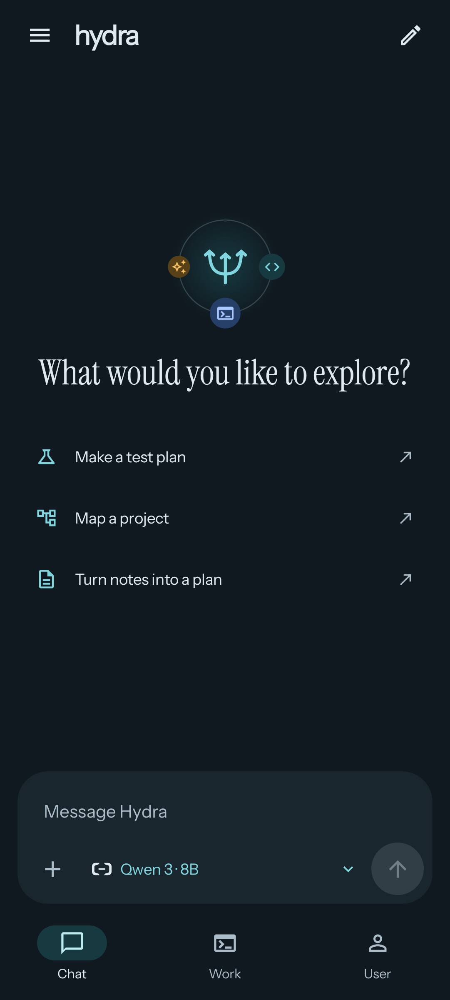
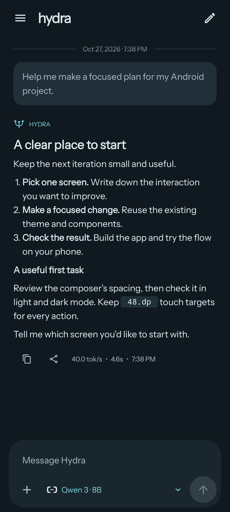
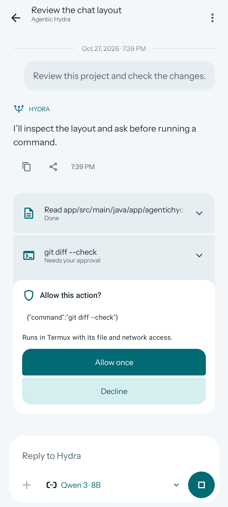
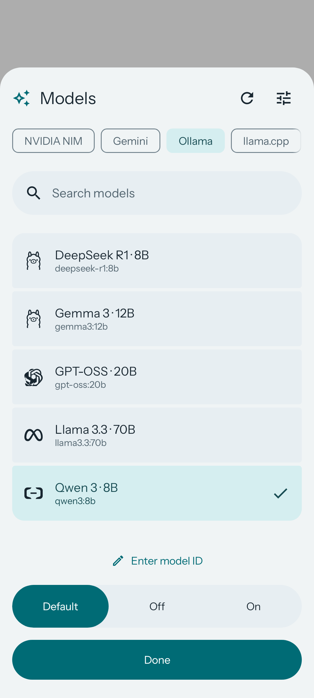

<p align="center">
  
</p>

<p align="center">
  <a href="https://github.com/theonlyasdk/AgenticHydra/actions/workflows/android.yml"></a>
  <a href="https://github.com/theonlyasdk/AgenticHydra/releases/latest"></a>
  
  <a href="LICENSE"></a>
</p>

**Agentic Hydra brings conversations and tool-assisted work to Android.** Chat with your preferred model, explore a project, research the web, and review actions as they happen—all in a native Kotlin and Jetpack Compose app.

Bring your own provider credentials or connect a local model server. Hydra does not require a Hydra account or bundle an inference engine.

<p align="center">
  <a href="https://github.com/theonlyasdk/AgenticHydra/releases/latest"><strong>Download the APK</strong></a> ·
  <a href="docs/GETTING_STARTED.md">Getting started</a> ·
  <a href="docs/BUILDING.md">Build from source</a> ·
  <a href="docs/TOOLS.md">Tool reference</a>
</p>

## A workspace that stays on your phone

| | What you can do |
| :-- | :-- |
| **Chat** | Stream responses, continue saved conversations, rename or export chats, and copy or share answers. Read Markdown with code blocks, tables, and response timing. |
| **Work** | Open a dedicated task conversation, select a project folder, attach files or images, and send follow-ups with the previous context. |
| **17 tools** | Read and edit files, search a project, search the web, fetch pages, inspect Git changes, and run commands through Termux. |
| **Visible approvals** | Inspect tool arguments and results inline. Allow or decline actions directly in the conversation, with configurable approval policies. |
| **Model choice** | Connect NVIDIA NIM, Gemini, Ollama, llama.cpp, or another OpenAI-compatible endpoint. Browse models, enter a custom ID, and adjust reasoning on supported models. |
| **Native feel** | Material 3 surfaces, dynamic color, light and dark themes, animated model controls, and daily greetings with rotating suggestions. |

## A closer look

Native app captures with demo conversations and a fixture model catalog. Light and dark themes are both shown; model availability depends on your provider.

<table>
  <tr>
    <td align="center"><br><strong>A calm place to start</strong></td>
    <td align="center"><br><strong>Readable conversations</strong></td>
  </tr>
  <tr>
    <td align="center"><br><strong>Actions you can review</strong></td>
    <td align="center"><br><strong>Your provider, your model</strong></td>
  </tr>
</table>

## Install

1. On an **Android 8.0+** device, open the [latest release](https://github.com/theonlyasdk/AgenticHydra/releases/latest).
2. Download **`Agentic-Hydra-release.apk`** from its assets. Allow your browser or file manager to install apps when Android asks, then install the APK.
3. Open **User → Connections**, choose a provider, enter its connection details, and check and save the connection.
4. Tap the model control in the composer, choose a model, and start a conversation.

For a local server, use an address reachable from your phone. `localhost` refers to the phone itself. API keys require HTTPS.

Official release APKs use a persistent signing key so updates can preserve app data. CI artifacts are separately signed previews; use Releases for normal installation. A SHA-256 checksum accompanies each published APK.

## Start a Work conversation

Open **Work → New task**. Use the composer's **+** menu to attach files or media, or choose a shared-storage project directory. Describe the task and review the inline permission requests as Hydra works. Reopen a saved task to continue it.

File and web tools run in the app. Shell commands and Git tools additionally need [Termux setup](docs/GETTING_STARTED.md#termux-for-shell-and-git). Your selected model must support OpenAI-compatible tool calling; image attachments also need a compatible vision model. Provider capabilities and usage charges vary.

## Build and contribute

The app targets Android API 35 and uses Kotlin, Jetpack Compose, Material 3, and Gradle's checked-in wrapper.

```sh
git clone https://github.com/theonlyasdk/AgenticHydra.git
cd AgenticHydra
./gradlew assembleDebug
```

Use JDK 17 or 21 with Android SDK 35 installed. On Windows, use `.\gradlew.bat assembleDebug`. See [Building](docs/BUILDING.md) for SDK configuration, tests, signing, and screenshot generation, and [Contributing](CONTRIBUTING.md) for project conventions.

## Data and control

Conversation history stays in app-private storage, and saved API keys are encrypted with Android Keystore. Prompts, relevant history, attachments, and tool results are sent to the provider you select. Web searches are sent to public search services. Hydra has no account service of its own.

Native file tools operate within the selected project. Termux commands run with Termux's permissions and can access more than that directory. Review commands before approving them. Stopping a task prevents subsequent steps; an already launched shell process may need to be stopped in Termux.

## License and credits

Hydra's source is available under the [MIT license](LICENSE). Bundled fonts and provider artwork retain their own licenses; see [Credits](docs/CREDITS.md). Provider names and logos identify integrations and do not imply endorsement.
